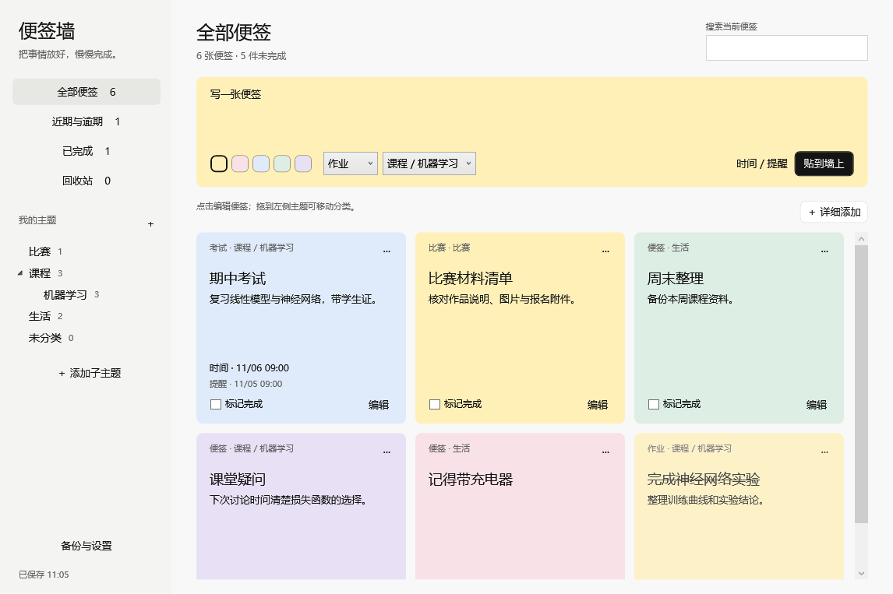
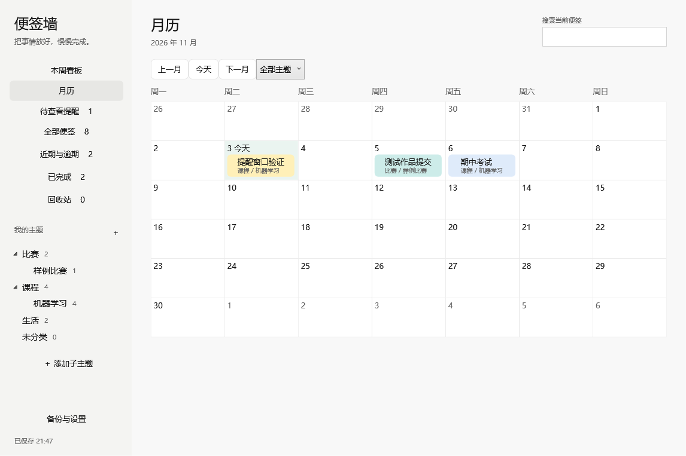
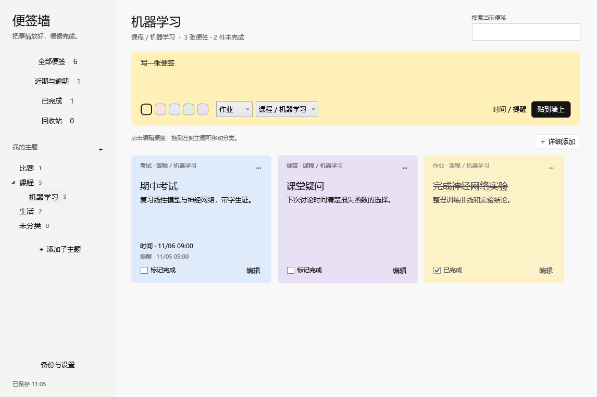

# Notes Wall · 便签墙

一个离线使用的 Windows 桌面便签墙。按主题整理比赛、课程、作业、考试时间和临时想法，需要时打开查看。

**[下载 Windows 64 位软件包](https://github.com/YuchuAn222/notes-wall/raw/refs/heads/main/releases/NotesWall-v1.1.0-win-x64.zip)**

解压整个文件夹后运行 `NotesWall.exe`，无需安装 Python、Node.js 或登录账号。请勿直接在 ZIP 预览中运行，保存时需要对解压目录有写入权限。



截图使用测试数据，不代表真实课程或考试安排。首次打开为默认主题和空白便签墙。

## v1.1.0

左栏可打开周看板、月历与待查看提醒。月历按事项日期排列，支持翻月、按主题筛选和双击日期新建。卡片可显示步骤进度，资料入口打开原网址、文件或文件夹。在详细编辑里可调整步骤顺序、勾选步骤、重命名资料或重新定位路径。

主题的右键菜单可设置默认色，便签可选择跟随主题或指定 12 种预设色之一。旧便签保留原色。提醒支持同一事项设置多个提前量，确认和延后分别作用于单个节点。登录或恢复时，未处理提醒会按事项汇总。关闭提醒后仍可在「待查看提醒」中处理。



## 功能

- 多层主题，例如“课程 → 机器学习 → 实验课”或“比赛 → 某个比赛”。
- 彩色便签，支持普通备注、作业、考试、比赛和提醒类型。
- 日期与提醒时间分别保存，可提前 10 分钟、1 小时或 1 天提醒；延后提醒不改变事项日期。
- 按标题、内容、类型和主题路径搜索；支持置顶、勾选完成与回收站恢复。
- 拖动便签顶部到左侧主题，或通过便签菜单移动分类。
- 自动保存未贴出的草稿、XML 数据备份，以及追加导入缺少的便签。



## 使用

1. 在左侧“我的主题”右侧点击加号，添加顶层主题；右键主题可添加子主题。
2. 选择主题，输入便签。第一行作为标题，后面的行作为内容，点击“贴到墙上”。
3. 点击“时间 / 提醒”或“详细添加”，设置日期、24 小时时间和提前提醒。
4. 点击卡片上的“编辑”修改内容，省略号菜单可以置顶、移动或放入回收站。

快捷键：`Ctrl+Enter` 贴到墙上，`Ctrl+N` 详细添加，`Ctrl+F` 搜索。

关闭主窗口会收到系统托盘，提醒继续运行。真正退出请使用托盘菜单或“备份与设置”中的退出选项。

**提醒需要软件正在运行、电脑保持开机。** 不会唤醒关机或休眠的电脑；尚未提醒的过期事项会在恢复运行后补弹。公开版默认关闭登录自启，可在「备份与设置」勾选「登录 Windows 后在托盘启动」。

## 数据与备份

内容仅保存在软件旁的 `data/wall.xml`，上一版为 `data/wall.xml.bak`。保存采用临时文件和原子替换，损坏主文件会尝试从备份恢复。移动软件时请保留整个文件夹。

“导入备份”只追加缺少的便签，同一张便签保留当前版本。完整恢复历史数据前，请先退出软件并另存现有 data 文件夹，再将历史备份复制为 `data/wall.xml`。

本仓库及下载包不包含个人便签、草稿、备份或登录凭据。所有图片均为软件测试内容。源码保留旧版本地 XML 格式的迁移支持，不会上传内容到网络。

## 从源码编译

环境：Windows 64 位、.NET Framework 4.x 的 WPF 与 C# 编译器。程序已在 Windows 11 本机验证。

```powershell
powershell.exe -NoProfile -ExecutionPolicy Bypass -File .\Build.ps1
```

输出到 `dist/NotesWall.exe`。启动时需要同目录下的 `wall.ico`，编译脚本会自动复制。

运行核心检查：

```powershell
powershell.exe -NoProfile -ExecutionPolicy Bypass -File .\Test.ps1
```

在交互式 Windows 桌面中运行控件与渲染检查：

```powershell
powershell.exe -NoProfile -ExecutionPolicy Bypass -File .\Test.ps1 -IncludeUI
```

重新生成不含运行数据的软件包：

```powershell
powershell.exe -NoProfile -ExecutionPolicy Bypass -File .\Package.ps1
```

核心检查、原有控件交互检查及 v1.1 比赛场景验收覆盖了改期、步骤、资料、漏提醒汇总与备份恢复。尚未完成多屏混合 DPI、长时间休眠唤醒和长期运行验证。

## 文件

| 路径 | 内容 |
| --- | --- |
| `src/` | 数据模型、存储、WPF 界面和检查代码 |
| `assets/wall.ico` | 软件图标 |
| `docs/` | 仅含测试数据的界面截图 |
| `Build.ps1` / `Test.ps1` | 编译与验证入口 |
| `Package.ps1` | 通过明确文件清单生成干净软件包 |
| `releases/` | 可以直接下载的软件包 |
